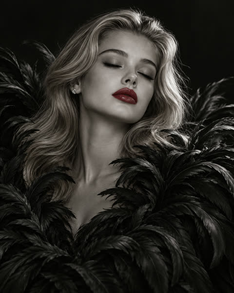
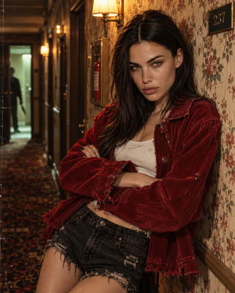
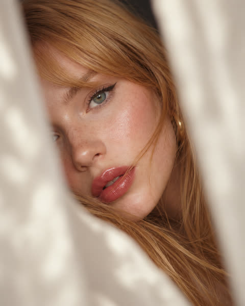
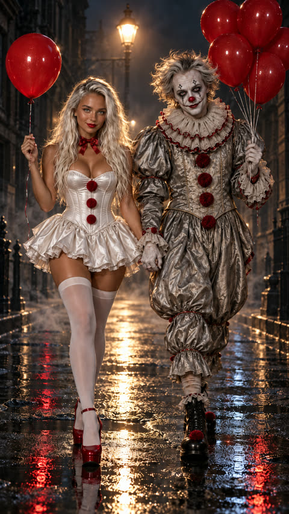
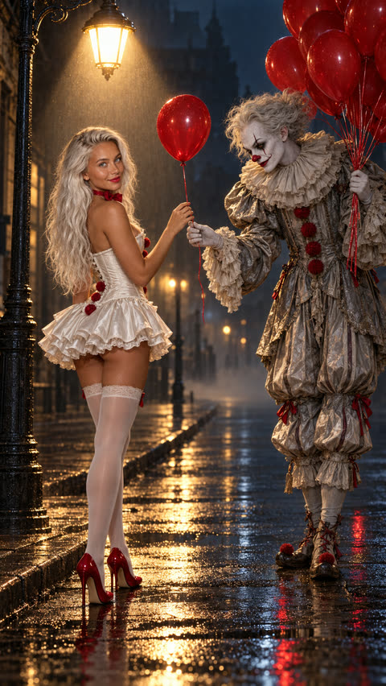
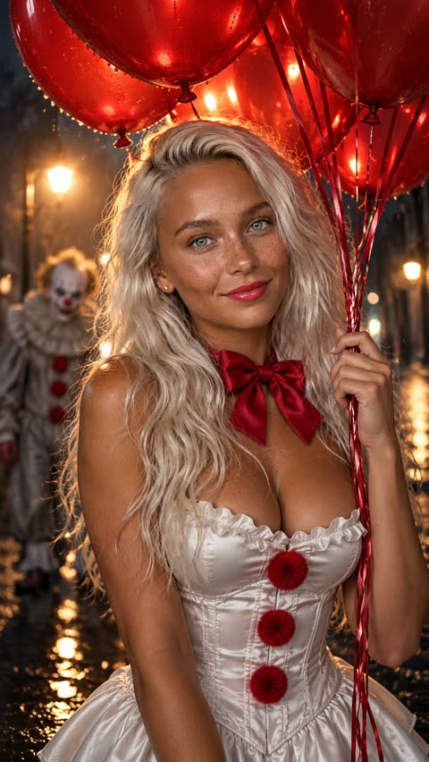
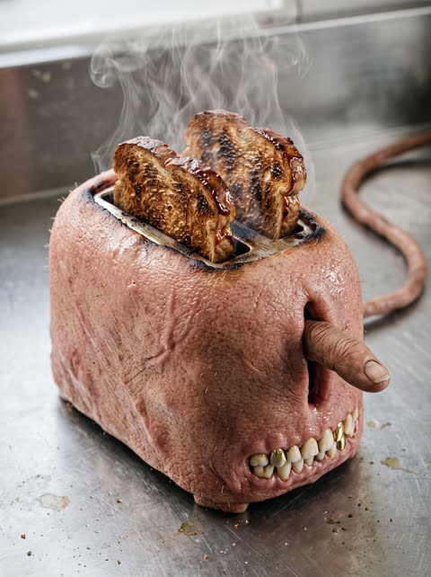
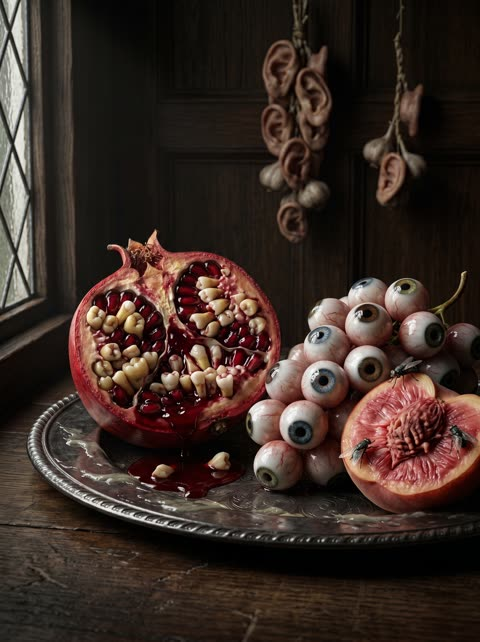

# 🩸 Dark Editorial & Surreal — 8 AI image prompts

Author: **@Yelpin** · Models: GPT Image 2.5, Nano Banana 2.1 · License: [CC BY 4.0](../LICENSE)

Prompts marked **Needs: reference photo** use a **[reference photo]** slot: attach your own photo and the model keeps the face, swapping only the scene, outfit and light. Values in `[square brackets]` are meant to be replaced.

More prompts: **[mozgi.io](https://mozgi.io/Prompt/?lang=en)**

---

## 01. A woman with closed eyes poses in a black feather gown against a dark background, her crimson lips in focus

<a href="https://mozgi.io/en/prompt/p34653"></a>

**Model:** GPT Image 2.5 · **Aspect ratio:** 4/5 · **Needs:** reference photo · [Open on mozgi.io](https://mozgi.io/en/prompt/p34653)

```text
Style and genre:
High-fashion monochrome editorial portrait, avant-garde fine-art photography, selective-color minimalism.
Visual effects:
Subtle subsurface light scattering along facial contours, micro-barb separation on individual feather tips, smooth analog tonal transitions, tactile skin pore texture.
Main subject:
[reference photo] — preserve identity 100%, without any changes to facial features, shape, proportions, skin tone, hair color, or hairstyle.
Pose and motion:
[serene editorial portrait pose with eyes closed, head tilted slightly upward, relaxed peaceful expression, face emerging from surrounding dark plumage].
Environment details:
Wearing [a voluminous sculptural gown crafted from layered matte black feathers framing the collar and shoulders, with satin crimson red lipstick applied as the sole color element in the frame].
Background and setting:
[pure seamless dark studio void], completely falling away into deep charcoal shadows without visible floor or wall boundaries.
Lighting:
Soft directional top-down key light sculpting the cheekbones and nose bridge, gentle rim lighting catching the outer feather edges, deep clean shadows surrounding the head.
Color palette:
Monochrome base with selective color, dominant [deep obsidian black and slate gray], pure focal accent [saturated vivid crimson red on the lips].
Image quality:
Ultra-high resolution 8K, Path Tracing, RAW, 4:5 aspect ratio, 85mm prime lens rendering, sharp focus on the lips and feather textures.
```

<details><summary>Русская версия</summary>

```text
Стиль и жанр:
Монохромный редакционный портрет в стиле высокой моды, авангардная художественная фотография, минимализм с выборочным цветом.
Визуальные эффекты:
Тонкое рассеяние света в подповерхностных слоях вдоль контуров лица, микроскопическое разделение отдельных кончиков перьев, плавные аналоговые тональные переходы, тактильная текстура пор кожи.
Главный объект:
[референсная фотография] — сохранить идентичность на 100%, без каких-либо изменений черт лица, формы, пропорций, тона кожи, цвета волос или прически.
Поза и движение:
[безмятежная поза для редакционного портрета с закрытыми глазами, голова слегка запрокинута вверх, расслабленное умиротворенное выражение лица, лицо выступает из окружающего темного оперения].
Детали окружения:
На [объемном скульптурном платье, созданном из многослойных матовых черных перьев, обрамляющих шею и плечи, с атласной насыщенно-красной помадой как единственным цветным элементом в кадре].
Фон и обстановка:
[чистое бесшовное темное пространство студии], полностью растворяющееся в глубоких угольно-серых тенях без видимых границ пола или стен.
Освещение:
Мягкий направленный верхний ключевой свет, моделирующий скулы и переносицу, деликатный контровой свет, подчеркивающий внешние края перьев, глубокие чистые тени вокруг головы.
Цветовая палитра:
Монохромная основа с выборочным цветом, доминирующие [глубокий обсидианово-черный и сланцево-серый], чистый акцентный цвет [насыщенный ярко-алый красный на губах].
Качество изображения:
Сверхвысокое разрешение 8K, Path Tracing, RAW, соотношение сторон 4:5, визуализация объективом 85mm prime, резкий фокус на губах и текстурах перьев.
```

</details>

[↑ Back to top](#-dark-editorial--surreal--8-ai-image-prompts)

---

## 02. A woman in a red corduroy jacket leans against a motel wall with a cold gaze

<a href="https://mozgi.io/en/prompt/p34652"></a>

**Model:** GPT Image 2.5 · **Aspect ratio:** 4/5 · **Needs:** reference photo · [Open on mozgi.io](https://mozgi.io/en/prompt/p34652)

```text
Style and genre:
Grungy 1980s retro-slasher fashion still, stylized Americana suspense editorial, 35mm Kodak film look.
Visual effects:
Harsh amber tungsten halation around exposed bulbs, optical blur on dirty motel glass, textured synthetic fabrics, authentic film grain structure.
Main subject:
[reference photo] — preserve identity 100%, without any changes to facial features, shape, or proportions; natural hair disheveled with dry textured volume.
Pose and motion:
[leaning back against the peeling floral wallpaper of a narrow motel hallway, arms crossed loosely, cold calculating sidelong glance toward an open door].
Environment details:
Wearing [an oversized distressed blood-red corduroy jacket over an unbranded white ribbed cotton tank top, worn black denim shorts, chipped black nail polish].
Background and setting:
[cramped suburban motel corridor with stained patterned carpeting], brass room numbers on scuffed doors, emergency fire extinguisher glass case behind.
Lighting:
Warm amber overhead hallway sconce casting hard diagonal shadows down the wall, cold green-white light spilling across the floorboards from an open doorway.
Color palette:
Aged vintage Americana tones, dominant [faded mustard gold and dirty wallpaper cream], bold pop [deep blood-red corduroy], grounding [charcoal shadow].
Image quality:
Ultra-high resolution 8K, Path Tracing, RAW, 4:5 aspect ratio, 35mm lens rendering, tangible texture on corduroy fabric, wallpaper, and skin.
```

<details><summary>Русская версия</summary>

```text
Стиль и жанр:
Потёртый ретро-слэшер в эстетике модной съёмки 1980-х, стилизованная редакционная съёмка в духе американской культуры и саспенса, плёночный вид 35mm Kodak.
Визуальные эффекты:
Жёсткое янтарное вольфрамовое свечение вокруг открытых ламп, оптическое размытие на грязном мотельном стекле, фактурные синтетические ткани, аутентичная структура плёночного зерна.
Главный объект:
[референсное фото] — сохранить идентичность на 100%, без каких-либо изменений черт лица, формы или пропорций; естественные растрёпанные волосы с сухим текстурированным объёмом.
Поза и движение:
[откинувшись назад на облупившиеся цветочные обои узкого коридора мотеля, руки небрежно скрещены, холодный расчётливый косой взгляд в сторону открытой двери].
Детали внешнего вида:
Одет(а) в [объёмную потёртую вельветовую куртку кроваво-красного цвета поверх белой рубчатой хлопковой майки без логотипа, потёртые чёрные джинсовые шорты, облупившийся чёрный лак на ногтях].
Фон и окружение:
[тесный коридор пригородного мотеля с покрытым пятнами узорчатым ковролином], латунные номера комнат на потёртых дверях, за спиной — стеклянный шкаф с огнетушителем.
Освещение:
Тёплый янтарный потолочный светильник в коридоре отбрасывает на стену жёсткие диагональные тени, холодный зеленовато-белый свет из открытого дверного проёма проливается на половицы.
Цветовая палитра:
Выцветшие винтажные оттенки американской культуры, доминирующие [выцветшее горчичное золото и грязно-кремовый цвет обоев], яркий акцент [глубокий кроваво-красный вельвет], уравновешивающий [угольно-серая тень].
Качество изображения:
Сверхвысокое разрешение 8K, Path Tracing, RAW, соотношение сторон 4:5, визуализация объектива 35mm, осязаемая текстура вельветовой ткани, обоев и кожи.
```

</details>

[↑ Back to top](#-dark-editorial--surreal--8-ai-image-prompts)

---

## 03. Close-up portrait of a woman with glossy red lips peeking through light fabric

<a href="https://mozgi.io/en/prompt/p34621"></a>

**Model:** GPT Image 2.5 · **Aspect ratio:** 4/5 · **Needs:** reference photo · [Open on mozgi.io](https://mozgi.io/en/prompt/p34621)

```text
Style and genre:
Intimate dreamlike fashion close-up, cinematic beauty editorial with a peeking-through-an-opening feel.

Visual effects:
Heavily blurred creamy-white foreground object (soft fabric or curtain edge) framing a narrow opening on both sides of the face, without covering the lips or eye. Lips and nearby skin crisply detailed with natural texture, loose hair strands falling naturally across the face, subtle film softness. No excessive smoothing, no artificial skin.

Main subject:
[reference photo] — preserve identity 100%: face, facial features, lip shape, skin tone, hair color, length and texture exactly as in the reference.

Pose and motion:
[sideways composition: the face tilted horizontally into the frame, lips and one eye visible through the gap, gaze soft toward the camera, lips slightly parted, asymmetrical framing].

Environment details:
Glossy [red] lips with natural volume, not oversized. A few loose strands of hair crossing the cheek and lips.

Background and setting:
[soft creamy white] foreground blur on both sides, the background behind the face in gentle shadow.

Lighting:
Soft diffused directional light from the side, gentle highlights on the lips and cheekbone, warm glow on the skin.

Color palette:
[creamy white], [glossy red], warm skin tones, the hair color from the reference as the deep contrast.

Image quality:
Photorealistic, 85mm f/1.4, very shallow depth of field, vertical 4:5, sharp focus on the lips, natural skin texture. No text or watermark.
```

<details><summary>Русская версия</summary>

```text
Стиль и жанр:
Интимный мечтательный крупный план в модной эстетике, кинематографичная бьюти-съёмка с ощущением взгляда сквозь проём.

Визуальные эффекты:
Сильно размытый кремово-белый объект на переднем плане (мягкая ткань или край занавески) обрамляет узкий проём по обе стороны лица, не закрывая губы или глаз. Губы и кожа вокруг них чётко прорисованы, с естественной текстурой, отдельные пряди волос естественно падают на лицо, лёгкая плёночная мягкость. Без чрезмерного сглаживания, без искусственного вида кожи.

Главный объект:
[референсное фото] — сохранить идентичность на 100%: лицо, черты лица, форму губ, тон кожи, цвет, длину и текстуру волос в точности как на референсе.

Поза и движение:
[боковая композиция: лицо горизонтально наклонено в кадр, губы и один глаз видны сквозь зазор, мягкий взгляд направлен в камеру, губы слегка приоткрыты, асимметричное кадрирование].

Детали окружения:
Глянцевые [красные] губы с естественным объёмом, не увеличенные. Несколько свободных прядей волос пересекают щёку и губы.

Фон и окружение:
[мягкое кремово-белое] размытие на переднем плане по обе стороны, фон позади лица погружён в мягкую тень.

Освещение:
Мягкий рассеянный направленный свет сбоку, нежные блики на губах и скуле, тёплое свечение на коже.

Цветовая палитра:
[кремово-белый], [глянцевый красный], тёплые оттенки кожи, цвет волос с референса в качестве глубокого контраста.

Качество изображения:
Фотореалистичное изображение, 85mm f/1.4, очень малая глубина резкости, вертикальный формат 4:5, резкий фокус на губах, естественная текстура кожи. Без текста и водяных знаков.
```

</details>

[↑ Back to top](#-dark-editorial--surreal--8-ai-image-prompts)

---

## 04. A woman and an eerie clown walk toward the camera on a wet night street in a cinematic fashion horror portrait

<a href="https://mozgi.io/en/prompt/p34614"></a>

**Model:** GPT Image 2.5 · **Aspect ratio:** 9/16 · [Open on mozgi.io](https://mozgi.io/en/prompt/p34614)

```text
Style and genre:
Hyperrealistic cinematic full-body portrait, eerie fashion editorial, dark fairy-tale horror mood without violence.

Visual effects:
Wet asphalt with mirror reflections of the streetlamp and red balloons in the puddles, light haze in the air, deep shadows, glossy latex sheen on the balloons, realistic satin and wet-street textures.

Main subject:
[reference photo of an adult woman] — preserve identity 100%: face, facial features, skin tone, hair color, length, texture and styling exactly as in the reference.

Pose and motion:
[she walks hand in hand with an eerie clown of original design down the middle of a wet dark street at night, both stepping toward the camera and looking straight into the lens; she holds one red balloon by its string in her free hand, the clown holds a bunch of five red balloons; her expression slightly flirtatious with a confident hint of a smile].

Environment details:
White satin corset with medium red pom-poms instead of buttons, white flared mini skirt, long white over-the-knee stockings, red very high heels, a red bow at the neck. Long lashes, delicate makeup, red lipstick. The clown: original design, vintage puffy silver-gray costume with ruffled collar, white face paint, red nose, unsettling calm smile, no recognizable film character.

Background and setting:
[wet dark city street at night], a single streetlamp behind them, dark buildings fading into haze.

Lighting:
Streetlamp backlight creating a strong rim on hair, shoulders and balloons, soft frontal fill revealing faces and white fabric, deep shadows at the edges.

Color palette:
[deep night blue-black], [white] outfit, [saturated red] balloons, bow, shoes and lips, warm lamp glow.

Image quality:
Hyperrealistic 8K, cinematic, camera at chest level, vertical 9:16, both figures fully in frame including shoes. No identity change, plastic skin, cartoonishness, extra fingers or limbs, fused bodies, wrong hand grip, text or watermark.
```

<details><summary>Русская версия</summary>

```text
Стиль и жанр:
Гиперреалистичный кинематографичный портрет в полный рост, жуткая фэшн-редакционная съёмка, мрачная атмосфера сказочного хоррора без насилия.

Визуальные эффекты:
Мокрый асфальт с зеркальными отражениями уличного фонаря и красных воздушных шаров в лужах, лёгкая дымка в воздухе, глубокие тени, глянцевый латексный блеск на шарах, реалистичные текстуры атласа и мокрой улицы.

Главный объект:
[референсная фотография взрослой женщины] — сохранить идентичность на 100%: лицо, черты лица, тон кожи, цвет, длину, текстуру и укладку волос в точности как на референсе.

Поза и движение:
[она идёт рука об руку с жутким клоуном оригинального дизайна по центру мокрой тёмной улицы ночью, оба направляются к камере и смотрят прямо в объектив; в свободной руке она держит один красный воздушный шарик за верёвочку, клоун держит связку из пяти красных воздушных шаров; её выражение слегка кокетливое, с уверенным намёком на улыбку].

Детали окружения:
Белый атласный корсет со средними красными помпонами вместо пуговиц, белая расклешённая мини-юбка, длинные белые чулки выше колена, красные туфли на очень высоком каблуке, красный бант на шее. Длинные ресницы, лёгкий макияж, красная помада. Клоун: оригинальный дизайн, винтажный пышный костюм серебристо-серого цвета с воротником-жабо, белый грим на лице, красный нос, тревожная спокойная улыбка, без узнаваемого персонажа из фильма.

Фон и обстановка:
[мокрая тёмная городская улица ночью], один уличный фонарь позади них, тёмные здания, растворяющиеся в дымке.

Освещение:
Контровой свет уличного фонаря создаёт яркий контур на волосах, плечах и воздушных шарах, мягкий фронтальный заполняющий свет подчёркивает лица и белую ткань, глубокие тени по краям.

Цветовая палитра:
[глубокий ночной сине-чёрный], наряд [белого цвета], воздушные шары, бант, туфли и губы [насыщенного красного цвета], тёплое свечение фонаря.

Качество изображения:
Гиперреалистичное 8K, кинематографичный стиль, камера на уровне груди, вертикальный формат 9:16, обе фигуры полностью в кадре, включая обувь. Без изменения идентичности, пластиковой кожи, мультяшности, лишних пальцев или конечностей, сросшихся тел, неправильного захвата за руки, текста или водяного знака.
```

</details>

[↑ Back to top](#-dark-editorial--surreal--8-ai-image-prompts)

---

## 05. Woman in a white costume takes a red balloon from a clown on a wet night street in a cinematic full-body portrait

<a href="https://mozgi.io/en/prompt/p34612"></a>

**Model:** GPT Image 2.5 · **Aspect ratio:** 9/16 · [Open on mozgi.io](https://mozgi.io/en/prompt/p34612)

```text
Style and genre:
Hyperrealistic cinematic portrait, eerie fashion editorial, dark fairy-tale mood without violence.

Visual effects:
Cone of lamplight through haze, puddle reflections, balloon strings catching the light.

Main subject:
[reference photo of an adult woman] — preserve identity 100%: face, facial features, skin tone, hair color, length, texture and styling exactly as in the reference.

Pose and motion:
[she stands under the streetlamp, the clown of original design bows slightly and offers her a single red balloon; she reaches for the string, glancing back at the camera with a sly smile].

Environment details:
White satin corset with red pom-poms, white flared mini skirt, white over-the-knee stockings, red high heels, red bow at the neck, red lipstick. The clown: original design, silver-gray ruffled costume, white face paint, red nose, holding a bunch of red balloons.

Background and setting:
[wet dark street at night], empty sidewalk, haze.

Lighting:
Overhead streetlamp as key, soft fill on faces, deep shadows outside the light cone.

Color palette:
[blue-black night], [white], [saturated red], warm lamp glow.

Image quality:
Hyperrealistic 8K, cinematic, full body, vertical 9:16, sharp faces, correct hands. No text or watermark.
```

<details><summary>Русская версия</summary>

```text
Стиль и жанр:
Гиперреалистичный кинематографичный портрет, жуткая фэшн-редакционная съёмка, мрачная сказочная атмосфера без насилия.

Визуальные эффекты:
Конус света от уличного фонаря сквозь дымку, отражения в лужах, нити воздушных шаров, ловящие свет.

Главный объект:
[референсное фото взрослой женщины] — сохранить идентичность на 100%: лицо, черты лица, тон кожи, цвет, длину, текстуру и укладку волос в точности как на референсе.

Поза и движение:
[она стоит под уличным фонарём, клоун в оригинальном дизайне слегка кланяется и протягивает ей один красный воздушный шар; она тянется к нити, оглядываясь на камеру с хитрой улыбкой].

Детали окружения:
Белый атласный корсет с красными помпонами, белая расклёшенная мини-юбка, белые чулки выше колена, красные туфли на высоком каблуке, красный бант на шее, красная помада. Клоун: оригинальный дизайн, серебристо-серый костюм с рюшами, белый грим, красный нос, держит связку красных воздушных шаров.

Фон и обстановка:
[мокрая тёмная улица ночью], пустой тротуар, дымка.

Освещение:
Уличный фонарь сверху как основной источник света, мягкий заполняющий свет на лицах, глубокие тени за пределами светового конуса.

Цветовая палитра:
[сине-чёрная ночь], [белый], [насыщенный красный], тёплое свечение фонаря.

Качество изображения:
Гиперреалистичное 8K, кинематографичный стиль, в полный рост, вертикальный формат 9:16, резкие лица, правильные руки. Без текста и водяных знаков.
```

</details>

[↑ Back to top](#-dark-editorial--surreal--8-ai-image-prompts)

---

## 06. A woman in a white corset holds red balloons on a wet night street with a blurred clown behind her

<a href="https://mozgi.io/en/prompt/p34611"></a>

**Model:** GPT Image 2.5 · **Aspect ratio:** 9/16 · [Open on mozgi.io](https://mozgi.io/en/prompt/p34611)

```text
Style and genre:
Hyperrealistic cinematic portrait, eerie fashion editorial.

Visual effects:
A canopy of red balloons above her head glowing from the backlight, raindrops on the balloons, haze, shallow depth of field.

Main subject:
[reference photo of an adult woman] — preserve identity 100%: face, facial features, skin tone, hair color, length, texture and styling exactly as in the reference.

Pose and motion:
[waist-up, she holds the strings of a whole bunch of red balloons above her head, chin raised, confident flirtatious smile into the camera; the clown of original design is a soft blurred figure in the background watching].

Environment details:
White satin corset with red pom-poms, red bow at the neck, red lipstick, delicate makeup, long lashes.

Background and setting:
[wet dark street at night] blurred into bokeh of streetlamps.

Lighting:
Warm backlight through the balloons, soft frontal fill on the face.

Color palette:
[saturated red], [white], [blue-black], warm glow.

Image quality:
Hyperrealistic 8K, 85mm f/1.8 look, vertical 9:16, sharp eyes. No text or watermark.
```

<details><summary>Русская версия</summary>

```text
Стиль и жанр:
Гиперреалистичный кинематографичный портрет, жуткая fashion-съёмка.

Визуальные эффекты:
Навес из красных воздушных шаров над её головой, светящихся в контровом свете, капли дождя на шарах, дымка, малая глубина резкости.

Главный объект:
[референсное фото взрослой женщины] — сохранить идентичность на 100%: лицо, черты лица, тон кожи, цвет, длину, текстуру и укладку волос в точности как на референсе.

Поза и движение:
[по пояс, она держит верёвочки целой связки красных воздушных шаров над головой, подбородок поднят, уверенная кокетливая улыбка в камеру; клоун оригинального дизайна — мягко размытая фигура на заднем плане, наблюдающая за ней].

Детали окружения:
Белый атласный корсет с красными помпонами, красный бант на шее, красная помада, нежный макияж, длинные ресницы.

Фон и место действия:
[мокрая тёмная улица ночью], размытая в боке уличных фонарей.

Освещение:
Тёплый контровой свет, проходящий сквозь воздушные шары, мягкий фронтальный заполняющий свет на лице.

Цветовая палитра:
[насыщенный красный], [белый], [сине-чёрный], тёплое свечение.

Качество изображения:
Гиперреалистичное 8K, вид в стиле 85mm f/1.8, вертикальный формат 9:16, резкие глаза. Без текста и водяных знаков.
```

</details>

[↑ Back to top](#-dark-editorial--surreal--8-ai-image-prompts)

---

## 07. A surreal toaster made of living flesh browns skin slices with steam on a steel kitchen counter

<a href="https://mozgi.io/en/prompt/p34597"></a>

**Model:** Nano Banana 2.1 · **Aspect ratio:** 3/4 · [Open on mozgi.io](https://mozgi.io/en/prompt/p34597)

```text
Style and genre:
Macro photography of a kitchen appliance, conceptual food art, surrealism.
Visual effects:
The Maillard effect on skin: characteristic darkening and wrinkling during heating. Distortion of the air (heat haze) rising from the slots. The texture of coagulated blood in the form of a glossy crust.
Main subject:
[kitchen toaster with a casing made of living flesh and teeth instead of buttons]
Pose and movement:
[two slices of toasted human skin pop out of the toaster slots, with heavy steam rising above them].
Environmental details:
Tooth-buttons with gold crowns, a lever made from [index finger], the casing’s texture resembles pigskin with sparse bristles.
Background and surroundings:
[minimalist stainless-steel kitchen], with visible drops of grease and organic streaks.
Lighting:
Hard overhead lighting emphasizing the relief of the charred skin and creating highlights on the enamel of the tooth-buttons.
Color palette:
Dominant [brown and toasted], accent [pink], details [steel gray].
Image quality:
Ultra-high resolution 8K, macro lens, Path Tracing, highly detailed steam.
```

<details><summary>Русская версия</summary>

```text
Стиль и жанр:
Макро-фотография кухонного прибора, концептуальный фуд-арт, сюрреализм.
Визуальные эффекты:
Эффект Майяра на коже: характерное потемнение и сморщивание при нагреве. Искажение воздуха (тепловое марево), поднимающееся из слотов. Текстура запекшейся крови в виде глянцевой корочки.
Основной объект:
[кухонный тостер с корпусом из живой плоти и зубами вместо кнопок]
Поза и движение:
[из слотов тостера выскакивают два ломтика обжаренной человеческой кожи, над ними поднимается тяжёлый пар].
Детали окружения:
Кнопки-зубы с золотыми коронками, рычаг из [указательного пальца], текстура корпуса напоминает свиную кожу с редкой щетиной.
Фон и окружение:
[минималистичная кухня из нержавеющей стали], на которой видны капли жира и органические подтёки.
Освещение:
Жёсткий верхний свет, подчёркивающий рельефность обгоревшей кожи и создающий блики на эмали зубов-кнопок.
Цветовая палитра:
Доминанта [коричнево-поджаристый], акцент [розовый], детали [стальной серый].
Качество изображения:
Ultra-high resolution 8K, макро-объектив, Path Tracing, высокая детализация пара.
```

</details>

[↑ Back to top](#-dark-editorial--surreal--8-ai-image-prompts)

---

## 08. Hyperrealistic surreal still life of a tooth-filled pomegranate, eyeball grapes and a peach on a silver platter in a dark kitchen

<a href="https://mozgi.io/en/prompt/p34595"></a>

**Model:** Nano Banana 2.1 · **Aspect ratio:** 3/4 · [Open on mozgi.io](https://mozgi.io/en/prompt/p34595)

```text
Style and genre:
Still life in the style of the Dutch masters, hyperrealism, biological surrealism.
Visual effects:
Wet surface effect: fruit juice has the consistency and viscosity of blood. Subsurface light scattering in the soft tissues of the fruit, revealing the capillary network beneath the skin.
Main subject:
[still life of fruits made up of human organs]
Pose and movement:
[pomegranate split open, with human teeth tightly packed inside instead of seeds; a bunch of grapes made up of eyeballs of different colors].
Environment details:
[silver dish with engraving], covered with a thin layer of sticky slime, flies with slender human fingers instead of legs, crawling over a sliced peach made of muscle tissue.
Background and surroundings:
[dark classical kitchen with oak paneling], with bunches of dried ears hanging in the background instead of garlic.
Lighting:
Hard side light from a narrow window, creating deep shadows and bright highlights on the enamel of the teeth and the wet surface of the eyes.
Color palette:
Dominant [deep burgundy], accent [ivory], shadows [umber].
Image quality:
Ultra-high resolution 8K, Path Tracing, macro detail, RAW.
```

<details><summary>Русская версия</summary>

```text
Стиль и жанр:
Натюрморт в стиле голландских мастеров, гиперреализм, биологический сюрреализм.
Визуальные эффекты:
Эффект влажной поверхности: сок фруктов имеет консистенцию и вязкость крови. Подповерхностное рассеивание света в мягких тканях плодов, проявляющее капиллярную сетку под кожицей.
Основной объект:
[натюрморт из фруктов, состоящих из человеческих органов]
Поза и движение:
[гранат разломлен, внутри вместо зерен плотно уложены человеческие зубы; виноградная гроздь состоит из глазных яблок разного цвета].
Детали окружения:
[серебряное блюдо с гравировкой], покрытое тонким слоем липкой слизи, мухи с тонкими человеческими пальцами вместо лапок, ползающие по разрезанному персику из мышечной ткани.
Фон и окружение:
[темная классическая кухня с дубовыми панелями], на заднем плане висят связки сушеных ушей вместо чеснока.
Освещение:
Жесткий боковой свет из узкого окна, создающий глубокие тени и яркие блики на эмали зубов и влажной поверхности глаз.
Цветовая палитра:
Доминанта [глубокий бордовый], акцент [слоновая кость], тени [умбра].
Качество изображения:
Ultra-high resolution 8K, Path Tracing, макро-детализация, RAW.
```

</details>

[↑ Back to top](#-dark-editorial--surreal--8-ai-image-prompts)

---

